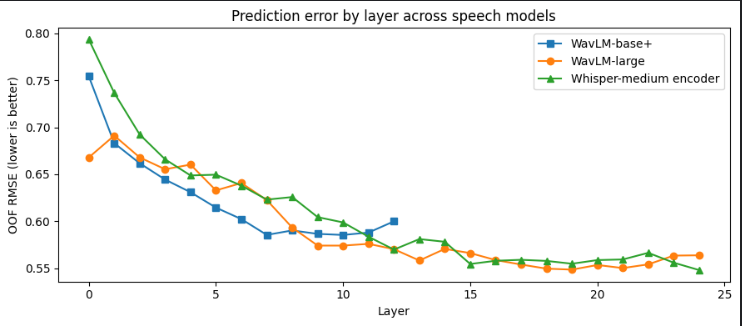
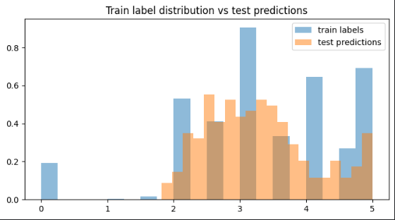

# Grammar Scoring Engine for Spoken English

Solution to the **SHL Hiring Assessment 2026** Kaggle challenge: predict a 0–5 grammar score (human MOS Likert rating) from a 45–60 second spoken audio clip.

| Metric | Value |
|---|---|
| Out-of-fold RMSE (5-fold, real responses) | **0.497** |
| Out-of-fold Pearson (5-fold, real responses) | **0.872** |
| Best public leaderboard RMSE | **0.376** |

Everything is in one notebook: [`shl_grammar_scoring.ipynb`](shl_grammar_scoring.ipynb). It contains the code, plots, training RMSE, and a written report.

---

## Approach in one paragraph

Grammar is judged from **how** someone speaks (fluency, hesitation, control) and **what** they say (sentence structure, errors). The model combines both. Three pretrained speech models (WavLM-base+, WavLM-large, Whisper-medium encoder) provide audio representations, taken from the layers that best predict the score. A Whisper transcript provides two text views: explicit grammar signals (LanguageTool error rates, a CoLA grammatical-acceptability classifier, fluency statistics) and a sentence embedding. Each view gets a small regressor, and a non-negative linear blend learned from out-of-fold predictions combines them.

```
            ┌─ WavLM-base+  (layers 7–11, mean+std) ─► SVR ─┐
audio ──────┼─ WavLM-large  (layers 17–21)          ─► SVR ─┤
            └─ Whisper-medium encoder (layers 22–24) ─► SVR ─┤
                                                             ├─► non-negative blend ─► score
 Whisper-small ─► transcript ─┬─ MPNet embedding ────► Ridge ─┤
                              └─ LanguageTool + CoLA + fluency ─► GBM ─┘
```

**Which layers predict grammar?** Error by layer for each speech model (out-of-fold RMSE, lower is better):



## How the result was reached

Each step was kept only if it improved **out-of-fold** error (never training error).

| Step | Change | OOF RMSE | Public LB |
|---|---|---|---|
| 1 | Transcript → 17 hand-crafted features → RandomForest | ~1.05 | 0.675 |
| 2 | Wav2Vec2 (last layer) → Ridge | 0.739 | 0.646 |
| 3 | + text embedding + grammar features, blended | 0.649 | 0.472 |
| 4 | WavLM-base+ with **layer probing** | 0.558 | 0.382 |
| 5 | + WavLM-large, + Whisper encoder, SVR | 0.496 | **0.376** |
| 6 | Train only on real responses (see findings) | 0.497* | 0.383 |

\* Measured on real responses only, which matches the test set. On that same measure step 5 scores 0.507. The public leaderboard is scored on ~130 clips, so differences below ~0.02 there are noise.

## Key findings

1. **Unscorable block.** All 37 clips labelled `0` are exactly `audio_5037`–`audio_5073`, with empty or off-topic transcripts. "0" means *unscorable*, not "very bad grammar" (there are almost no 1.0–1.5 labels), and the test set contains no such clips. Training on the 732 real responses matches the test distribution and improved the text-based views most.
   

2. **Layer choice matters more than model choice.** For WavLM, the upper-middle layers beat the last layer, which specialises in its pre-training objective. For Whisper's encoder, the last layers are best, since they're trained to feed a text decoder.
3. **Audio is the strongest single signal** (~0.53 vs ~0.75 RMSE for text), but text still carries ~30% of the blend weight: the views are complementary.
4. **Remaining error is regression toward the mean:** weak speakers are slightly over-scored and strong speakers under-scored.

## Running it

1. Open the notebook in the competition on Kaggle, with **GPU (T4)** and **Internet** enabled.
2. **Run All.** From scratch this takes ~2 hours (transcription and three embedding extractions).
3. Every expensive step caches its output in `/kaggle/working`. To skip recomputation, upload these files as a Kaggle dataset and attach it. The notebook finds them automatically:
   `transcriptions.csv`, `text_features.npz`, `wavlm_layers.npz`, `wavlm_large_layers.npz`, `whisper_enc_layers.npz`

Output: `submission.csv` (216 rows, `filename,label`).

## Repository contents

| File | Purpose |
|---|---|
| `shl_grammar_scoring.ipynb` | Full pipeline, evaluation, and report |
| `submission.csv` | Final predictions |
| `requirements.txt` | Packages beyond the standard Kaggle image |
| `images/` | Figures used in this README |

## Limitations and next steps

- The model never outputs the "unscorable" category. A production system would add a separate silence/off-topic detector.
- Next: fine-tune the best speech encoder end-to-end with a regression head; try ordinal or distribution-aware losses to reduce compression toward the mean; use verbatim (disfluency-preserving) transcription.
